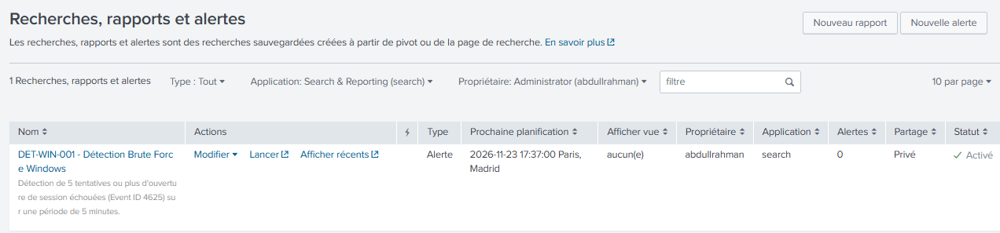
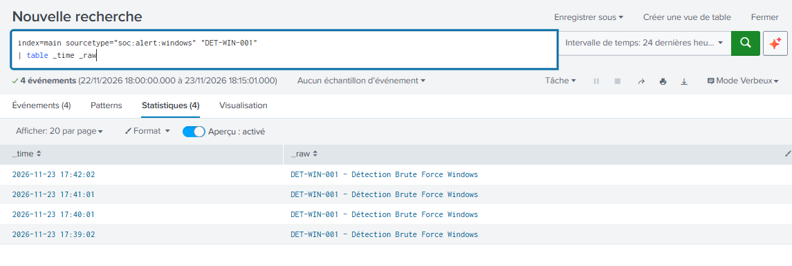
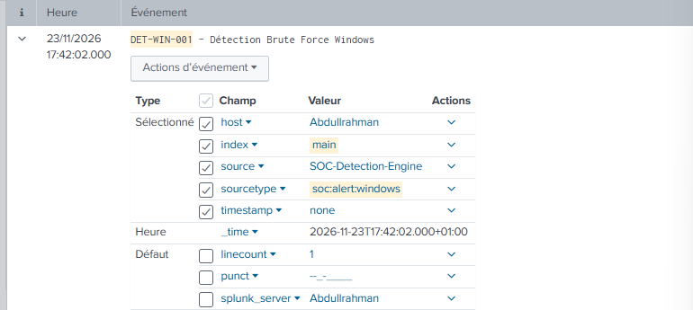
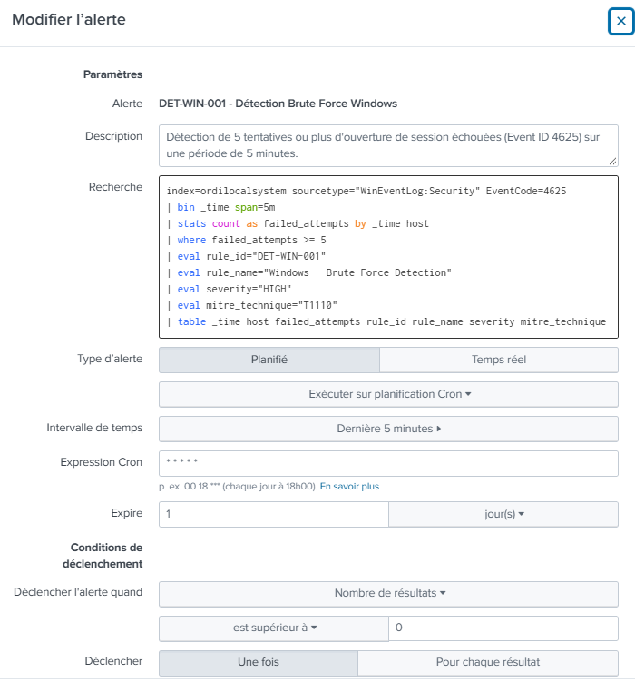
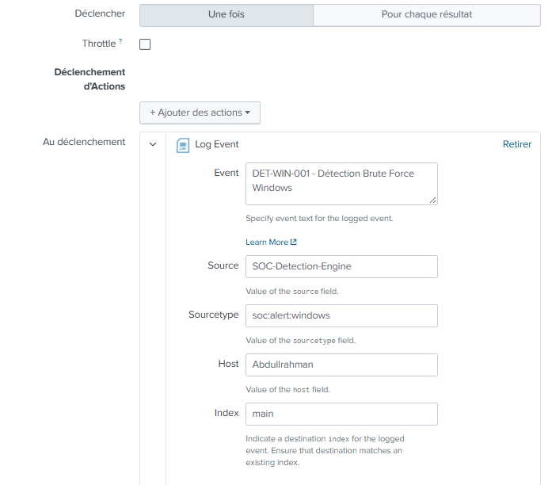

# TP05 – Détection des tentatives de connexion échouées Windows avec Splunk

## 1. Présentation du TP

Ce TP a pour objectif de mettre en place un mécanisme de détection personnalisé dans Splunk afin d'identifier des comportements suspects liés aux tentatives de connexion échouées sur un poste Windows 11.

L'exercice consiste à collecter les événements de sécurité Windows, à analyser les tentatives d'authentification échouées et à concevoir une règle de détection personnalisée permettant d'identifier un comportement pouvant correspondre à une attaque par force brute (*Brute Force*).

Un mécanisme de détection personnalisé, organisé autour de `SOC-Detection-Engine`, est utilisé pour analyser les événements et générer des alertes exploitables dans Splunk.

**Environnement technique :**
- Splunk Enterprise
- Windows 11
- Journaux Windows Security
- SPL (Search Processing Language)
- SOC-Detection-Engine

## 2. Objectifs

- Collecter les événements de sécurité Windows dans Splunk.
- Identifier les tentatives de connexion échouées à partir de l'Event ID 4625.
- Comprendre et exploiter les événements d'authentification Windows.
- Concevoir une règle de détection personnalisée.
- Simuler des tentatives de connexion échouées dans un environnement de test.
- Vérifier le fonctionnement de la détection.
- Générer et indexer des alertes personnalisées dans Splunk.
- Exploiter les résultats pour réaliser une première analyse SOC.

## 3. Scénario de détection

Dans ce scénario, plusieurs tentatives de connexion échouées sont volontairement réalisées sur le poste Windows 11 afin de simuler un comportement susceptible de correspondre à une attaque par force brute.

L'objectif est de vérifier si le mécanisme de détection personnalisé est capable d'identifier ces événements et de produire une alerte exploitable.

**Événement Windows surveillé :**

| Élément | Valeur |
|---|---|
| Event ID | 4625 |
| Description | Échec d'une tentative d'ouverture de session Windows |
| Journal | Security |
| Sourcetype | WinEventLog:Security |
| Index source | ordilocalsystem |

**Principe de détection :**

Les événements 4625 sont collectés dans Splunk. Une recherche SPL permet ensuite d'analyser leur fréquence d'apparition et d'identifier les comportements correspondant aux conditions de détection définies.

## 4. Création et configuration de la règle personnalisée

### 4.1. Pourquoi créer une règle personnalisée ?

Les événements Windows permettent de connaître les tentatives d'authentification échouées, mais leur simple collecte ne suffit pas à identifier automatiquement un comportement suspect.

J'ai donc créé une règle de détection personnalisée afin de transformer les événements collectés en alertes exploitables dans le cadre d'une supervision SOC.

Cette règle permet de centraliser la détection dans Splunk et de faciliter l'identification des comportements pouvant correspondre à une attaque par force brute.

### 4.2. Identification et nommage de la règle

J'ai attribué à ma règle un identifiant unique : `DET-WIN-001`.

Cet identifiant suit une convention de nommage permettant de distinguer les règles de détection personnalisées et de faciliter leur identification dans les recherches, les alertes et les rapports d'investigation.

La règle possède les caractéristiques suivantes :

| Élément | Valeur |
|---|---|
| Identifiant | DET-WIN-001 |
| Nom | Détection Brute Force Windows |
| Mécanisme | SOC-Detection-Engine |
| Source des alertes | SOC-Detection-Engine |
| Sourcetype de sortie | soc:alert:windows |
| Index de sortie | main |

### 4.3. Construction de la recherche SPL

La logique de détection repose sur une recherche SPL exploitant les événements Windows 4625.

La recherche permet de regrouper les événements par période et par machine, puis d'analyser le nombre de tentatives échouées.

```spl
index=ordilocalsystem sourcetype="WinEventLog:Security" EventCode=4625
| bin _time span=5m
| stats count as failed_attempts by _time host
| where failed_attempts >= 5
| eval rule_id="DET-WIN-001"
| eval rule_name="Windows - Brute Force Detection"
| eval mitre_technique="T1110"
| table _time host failed_attempts rule_id rule_name mitre_technique
```

**Explication des principales commandes :**

| Commande | Rôle |
|---|---|
| `index=ordilocalsystem` | Sélectionne l'index contenant les événements Windows |
| `EventCode=4625` | Filtre les échecs d'authentification |
| `bin _time span=5m` | Regroupe les événements par périodes de cinq minutes |
| `stats count` | Calcule le nombre d'événements |
| `where failed_attempts >= 5` | Sélectionne les groupes répondant à la condition de détection |
| `eval rule_id` | Associe un identifiant à la détection |
| `eval rule_name` | Définit le nom de la détection |
| `eval mitre_technique` | Associe la technique MITRE ATT&CK T1110 |

Cette recherche constitue le cœur de la logique de détection.

### 4.4. Intégration au SOC-Detection-Engine

La détection est intégrée au mécanisme personnalisé `SOC-Detection-Engine` à travers une recherche sauvegardée dans Splunk.

La configuration de l'alerte permet d'exécuter la recherche et d'utiliser l'action de journalisation (*Log Event*) pour enregistrer un événement personnalisé dans Splunk.

L'événement généré est associé aux informations suivantes :

- Identifiant de détection : `DET-WIN-001`
- Nom : `Détection Brute Force Windows`
- Source : `SOC-Detection-Engine`
- Sourcetype : `soc:alert:windows`
- Index : `main`

**Capture – Création et configuration de l'alerte :**



### 4.5. Vérification du fonctionnement

Après la configuration, j'ai effectué plusieurs simulations de tentatives de connexion échouées sur mon environnement Windows 11.

J'ai ensuite vérifié l'exécution de la recherche sauvegardée et la génération des événements personnalisés.

Les informations de fonctionnement ont notamment été vérifiées dans les journaux internes de Splunk (`_internal`), ainsi que dans l'index de destination `main`.

## 5. Collecte et recherche des événements Windows

Les événements de sécurité Windows sont collectés et indexés dans Splunk.

Recherche SPL utilisée pour retrouver les tentatives de connexion échouées :

```spl
index=ordilocalsystem sourcetype="WinEventLog:Security" EventCode=4625
| table _time host EventCode Account_Name Source_Network_Address
| sort - _time
```

Cette recherche permet de retrouver les événements 4625 et d'examiner les informations associées aux tentatives d'authentification échouées.

**Capture – Événements de sécurité Windows détectés :**



## 6. Vérification des alertes générées

Les alertes produites par le mécanisme de détection personnalisé sont enregistrées dans l'index `main`, avec le sourcetype `soc:alert:windows`.

Recherche SPL utilisée :

```spl
index=main sourcetype="soc:alert:windows"
| stats count AS nombre_alertes by host source sourcetype
```

**Résultat observé lors du test :**

| Champ | Résultat |
|---|---|
| Host | Abdullrahman |
| Source | SOC-Detection-Engine |
| Sourcetype | soc:alert:windows |
| Index | main |
| Nombre d'événements retrouvés | 4 |

Une recherche complémentaire permet d'identifier les événements associés à la règle `DET-WIN-001` :

```spl
index=main sourcetype="soc:alert:windows" "DET-WIN-001"
| table _time host source sourcetype _raw
| sort - _time
```

Cette recherche permet d'examiner le contenu brut des alertes générées et de retrouver les informations associées à la détection.

**Capture – Recherche de l'alerte personnalisée :**



**Capture – Détails de l'alerte générée :**





## 7. Analyse des résultats

Les recherches effectuées permettent de constater la présence d'événements Windows correspondant à des échecs d'authentification ainsi que des alertes personnalisées enregistrées dans Splunk.

Quatre événements ont été retrouvés dans l'index `main`, associés à la source `SOC-Detection-Engine`.

Une alerte portant l'identifiant `DET-WIN-001` et le nom `Détection Brute Force Windows` a également été observée.

Les vérifications dans les journaux internes de Splunk ont permis de constater plusieurs exécutions réussies de la recherche sauvegardée, avec génération d'événements via l'action `logevent`.

Ces observations constituent des éléments de preuve du fonctionnement du mécanisme de génération et d'indexation des alertes.

Il est important de distinguer :
- L'événement Windows 4625, qui constitue la donnée source analysée.
- L'identifiant DET-WIN-001, qui identifie ma détection personnalisée.
- L'événement `soc:alert:windows`, qui correspond à la sortie générée et enregistrée dans Splunk.

## 8. Compétences développées

- Collecte et exploitation des journaux de sécurité Windows.
- Analyse des événements d'authentification.
- Recherche et filtrage avec SPL.
- Compréhension des mécanismes de détection d'une attaque par force brute.
- Conception et configuration de recherches de détection personnalisées.
- Création et configuration d'alertes dans Splunk.
- Exploitation des journaux internes de Splunk.
- Analyse et vérification des alertes de sécurité.
- Exploitation d'un SIEM : Splunk Enterprise.

## 9. Conclusion

Ce TP m'a permis de découvrir et de mettre en pratique les fonctionnalités de Splunk dans le cadre d'une activité de détection et de supervision de la sécurité.

J'ai travaillé sur la collecte des événements Windows, l'analyse des échecs d'authentification, la conception d'une recherche SPL personnalisée et la génération d'alertes à travers un mécanisme de détection dédié.

La création de `DET-WIN-001` m'a notamment permis de comprendre comment transformer des événements bruts en alertes exploitables et comment vérifier leur génération et leur indexation dans un SIEM.

Ce laboratoire constitue une première mise en pratique des missions d'un analyste SOC : surveiller les événements, identifier les comportements suspects, vérifier les alertes et exploiter les données disponibles pour orienter une investigation.

## 10. Rapport d'investigation

Pour consulter les manipulations détaillées, les observations, les captures complémentaires et l'analyse des résultats :

[Consulter le rapport d'investigation du TP05](rapports/TP05-rapport-investigation.md)
